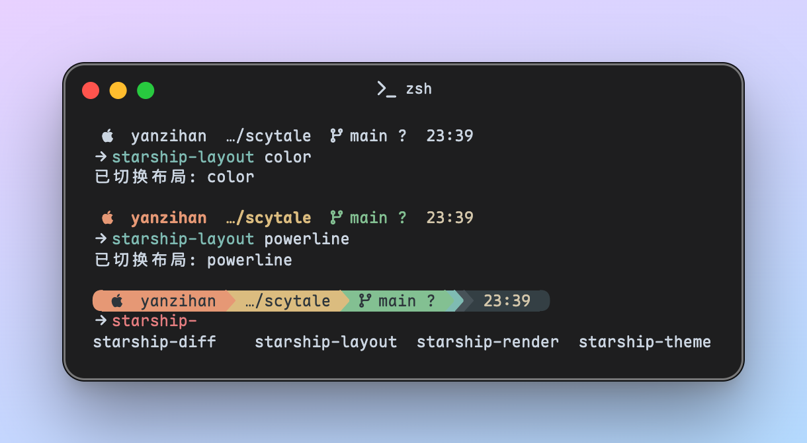

# Scytale

A multi-theme [Starship](https://starship.rs) prompt with three switchable layouts, optionally
kept in sync with `zsh-syntax-highlighting` on macOS.

Named after the Dune face dancer. Because a prompt that changes shape is still the same prompt.


## Features

- **14 palettes** behind one stable set of semantic color tokens
- **3 layouts**: `powerline` (color chips + arrows), `color` (colored text, no background), `plain` (monochrome)
- **Automatic light/dark** switching following macOS appearance
- **One command** to switch: `starship-theme everforest light`
- **Optional sync** with `zsh-syntax-highlighting`, so prompt and shell highlighting never disagree
- Palette and layout are independent: 14 × 3 = 42 combinations

| Family | Palettes |
|---|---|
| Everforest | `everforest_light`, `everforest_dark` |
| Gruvbox | `gruvbox_light`, `gruvbox_dark` |
| Catppuccin | `catppuccin_latte`, `catppuccin_frappe`, `catppuccin_macchiato`, `catppuccin_mocha` |
| Nord | `nord` (dark only; `light`/`dark`/`auto` all resolve to it) |
| Tokyo Night | `tokyonight_night`, `tokyonight_storm`, `tokyonight_moon`, `tokyonight_day` |
| Monokai | `monokai` (classic, dark only) |

## Requirements

- [Starship](https://starship.rs) 1.18+ (user-defined palettes)
- zsh
- Python 3 (used only when swapping the layout block in `starship.toml`)
- Optional: catppuccin syntax highlighting themes
  ```sh
  git clone https://github.com/catppuccin/zsh-syntax-highlighting \
    ~/.zsh/themes/zsh-syntax-highlighting
  ```

## Install

```sh
git clone https://github.com/AkiYatsuki/scytale
cd scytale
./install.sh
exec zsh
```

`install.sh` does four things:

1. Symlinks the zsh scripts and themes into `~/.zsh/`
2. Copies `starship/starship.toml` to `~/.config/starship.toml` (skipped if it already exists; use `--force` to overwrite)
3. Creates `~/.config/starship-theme` and `~/.config/starship-layout` if missing
4. Appends a marked `source` block to `~/.zshrc`

The repo stays the source of truth: the symlinked scripts read layouts from the repo,
and `starship.toml` is treated as a generated file that the scripts rewrite in place.

## Usage

```sh
starship-theme                      # current theme + available options
starship-theme everforest auto      # follow macOS light/dark (default)
starship-theme everforest light     # pin light
starship-theme gruvbox dark         # pin dark
starship-theme catppuccin frappe    # pick a specific flavor
starship-theme nord                 # Nord（单一深色配色）
starship-theme tokyonight storm     # Tokyo Night 的 storm 变体
starship-theme monokai              # Monokai Classic（单一深色配色）

starship-layout                     # current layout + options
starship-layout powerline           # chips + arrows (default)
starship-layout color               # colored text only
starship-layout plain               # monochrome
starship-layout reload              # re-render the layout block after editing it
starship-render                     # regenerate ~/.config/starship.toml from the template
starship-diff                       # is ~/.config/starship.toml drifted from the template?
```

## How it works

Colors are not attached to modules. Every module emits plain text, and the entire
visual chrome lives in the top-level `format` string:

```toml
# powerline
[$directory](bg:color_yellow fg:color_fg0)

# color
[$directory](bold fg:color_yellow)

# plain
$directory
```

### Template vs. instance

There are exactly two `starship.toml` files:

| Path | Role | Modified by |
|---|---|---|
| `starship/starship.toml` (repo) | template / source of truth | you, by hand |
| `~/.config/starship.toml` | runtime instance, what Starship reads | scripts, on 2 lines only |

Nothing generates the template back from the instance, so local edits are one-way
drift. Use `starship-diff` to see the difference and `starship-render` to overwrite
the instance from the template while keeping your current palette and layout.

That is why switching layouts only touches one block. Each layout is a file in
`starship/layouts/`, delimited in `starship.toml` by a marker:

```toml
# layout: powerline
format = """..."""
```

`starship-layout` swaps that block (via Python, since TOML has no includes and
multi-line `sed` is fragile). `starship-theme` only rewrites the single
`palette = "..."` line. State lives in `~/.config/starship-{theme,layout}`, so
nothing generated pollutes git.

### Semantic tokens

All palettes expose the same 11 keys, which is what makes them interchangeable:

| Token | Role |
|---|---|
| `color_fg0` | ink on accent chips (contrast against every accent) |
| `color_text` | normal text (time, docker, conda, pixi) |
| `color_bg1` | background of the outer `time` segment |
| `color_bg3` | background of the `docker` / `conda` / `pixi` segment |
| `color_{blue,aqua,green,orange,purple,red,yellow}` | accent per segment |

Add your own palette by copying any `[palettes.*]` block and filling these keys.

## Customizing

- Edit `starship/layouts/*.toml`, then run `starship-layout reload`.
- Edit `starship/starship.toml` for palettes and module definitions.
- Add a syntax-highlighting theme as `themes/<family>-<mode>.zsh`.

Layout changes are not reflected until `reload` (or a layout switch) because the
block is copied into `~/.config/starship.toml`.

## Credits

Palette values come from [Catppuccin](https://github.com/catppuccin),
[Everforest](https://github.com/sainnhe/everforest),
[Gruvbox](https://github.com/morhetz/gruvbox), [Nord](https://www.nordtheme.com/),
[Tokyo Night](https://github.com/folke/tokyonight.nvim) and
[Monokai](https://monokai.pro/).
Catppuccin syntax-highlighting
themes belong to [catppuccin/zsh-syntax-highlighting](https://github.com/catppuccin/zsh-syntax-highlighting).

## License

MIT
